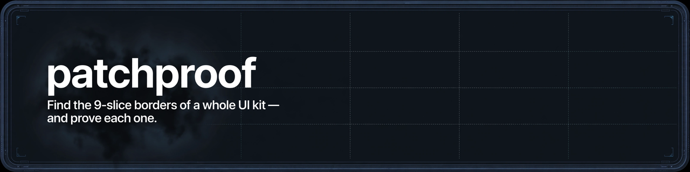

[](LICENSE)
[](#how-it-works)
[](https://github.com/RakTikoo/patchproof/releases)

# patchproof

**Find the 9-slice borders of a whole folder of game UI panels, prove each one by re-rendering it, and write the engine files — or honestly say "uncertain" when a panel can't be sliced cleanly.**

Unity, Godot and Unreal all *use* 9-slice borders, but none of them works the numbers out: you drag handles or type four values per panel, by hand, for every panel in a kit. patchproof does the whole kit in one run. Every detection is verified by resynthesis — the panel is re-rendered 9-sliced at several sizes (including odd sizes) and its corners must come out pixel-identical — and every panel gets a distortion score and a verdict. Panels that don't prove out are reported `UNCERTAIN` with a reason, never given made-up numbers.


## Demo

```
$ patchproof scan examples --out out
file                         verdict       L    R    T    B  score
demo_compare.png             PROVEN      252   18   28   28  1.78
panel_asym.png               PROVEN       10   22    8   16  0.00
panel_flat.png               PROVEN       14   14   14   14  0.55
panel_gradient.png           PROVEN       12   12   12   12  0.56
panel_ornament.png           PROVEN       18   18   18   18  0.00
panel_padded.png             PROVEN       22   22   22   22  0.55
panel_photo.png              UNCERTAIN     -    -    -    -  no cleanly stretchable centre found: best distortion score 29.2 is above the threshold 6.0 (content is likely photo-like, patterned, or ornamented through its middle)
6 proven, 1 uncertain -- report: out/report.json
```

(`demo_compare.png` is the comparison picture above, not a panel — it still slices cleanly because both halves share the same flat centre. `panel_photo.png` is a photo-like image with no valid slice, and patchproof abstains on it.)

For every `PROVEN` panel you get, in the output folder:

- the panel PNG, plus a **Unity `.meta` sidecar** (`panel.png.meta`) with the `spriteBorder` filled in,
- a **Godot `.tres`** `StyleBoxTexture` with the patch margins and content margins set,
- an **Android `.9.png`** with the marker border drawn,
- and `report.json` covering every panel: borders, content padding, verdict, score, sizes checked.

## Install

```
pip install git+https://github.com/RakTikoo/patchproof
```

Python 3.10+, Pillow and numpy. Everything runs locally on CPU; no panel ever leaves your machine.

## Usage

```
patchproof scan <file-or-folder> --out <dir> [--threshold 6.0]
```

- A folder is scanned non-recursively for PNGs; a single PNG file works too.
- Content padding (transparent margins around the panel) is detected and reported separately from the borders, and lands in the Godot content margins and the `.9.png` content box.
- `--threshold` sets how clean a slice must be to earn `PROVEN` (lower = stricter).

## How it works

1. **Stretchability profile.** A column can sit in the stretched centre if the image is locally *linear* along x there — flat fills and smooth gradients stretch losslessly, ornaments don't. Second-difference profiles give a first guess at the borders.
2. **Settle.** Borders are then adjusted against a distortion score: the worst per-row/per-column linear-fit residual over the centre and edge strips. Borders shrink while the score stays under the threshold (minimal borders) and expand while it's over.
3. **Cross-check + texture path.** A second, independent estimator finds the borders from the step in the per-column/per-row *mean* colour profile (grain averages out of a mean; a frame's mean colour does not). A borderline pass from steps 1–2 that this estimator disputes is not trusted. Its borders can still be proven for **stationary-texture centres** (parchment-style grain): the centre's mean profile must be flat within the same threshold, and the centre must not have a strong repeating period — stretching a regular pattern would rescale the pattern itself, so patterned centres still abstain.
4. **Proof by resynthesis.** The panel is re-rendered 9-sliced at 5+ sizes, odd sizes included. Corners must be pixel-identical to the original; the distortion score must be under the threshold. Both, or the verdict is `UNCERTAIN`.

On the synthetic ground-truth suite in `tests/` (flat, gradient, ornamented, asymmetric, transparent-padded, and small/large panels), patchproof recovers **28 of 28 border sides exactly** (100% exact, 100% within 1px). Run it yourself:

```
python3 run_tests.py
```

17 tests: border recovery, the resynthesis corner invariant, Unity/Godot/Android export round-trips, abstention on photo-like and diagonally-striped images, flip symmetry, and malformed-input handling (empty folder, non-PNG, 1×1, fully transparent, huge flat image — clean one-line errors or sensible verdicts, never a traceback).

## Honest limits

- **Centres must be flat, smoothly gradient, or stationary grain.** Parchment-style texture (grain whose average colour is the same everywhere) can now be proven, under a statistical criterion: stretching preserves the centre's mean structure, though the grain itself rescales — as it does with any stretch of a real texture. **Repeating patterns and directional grain still abstain**: a checker, brick or diamond fill, or wood grain with a visible period, would have its pattern period changed by stretching, so such panels (correctly) come back `UNCERTAIN` rather than get numbers that would distort them. Panels whose centre should be *tiled* rather than stretched are not modelled yet.
- **One panel per image.** Sprite sheets / atlases with several panels in one PNG are not segmented yet.
- **Detection is a judgement call on ornate panels.** The score tells you how clean the slice is; a low score is a proof about stretching, not about taste. Borderline kits should use a stricter `--threshold` and eyeball the `UNCERTAIN` pile.
- **Exports are written from the detection, not validated inside the engines.** The `.meta` and `.tres` files are format-faithful (and round-trip tested), but the first import into a real Unity/Godot project is still worth a look.
- Panels are processed in memory as full images; a 2000×1500 panel is fine, a folder of 8K textures will be slow.
- PNG only for now.

## License

MIT — see `LICENSE`. Free for science, games, and everything else.
